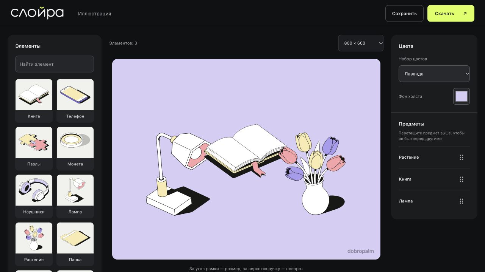

# Слойра

Редактор, в котором можно собрать иллюстрацию из готовых SVG-предметов, настроить композицию и скачать результат для дальнейшего редактирования.

[Попробовать редактор](https://dobropalm.tech/demos/svg-studio/) · [Проект в портфолио](https://dobropalm.tech/ru/#sloyra)



## Задача

Сделать рабочий конструктор из предоставленной библиотеки иллюстраций. Пользователь должен получать начальную композицию по описанию или названиям предметов, затем менять её вручную. Важно сохранить векторный формат, варианты исходных предметов и правила палитры.

Проект выполнен как тестовое задание для Студии Очень / Снэпбилд и включён в портфолио.

## Что получилось

- Подбор предметов по названиям и описанию из ограниченного словаря тем.
- Перемещение, поворот и изменение размера за ручки рамки; жест двумя пальцами.
- Перестановка слоёв перетаскиванием списка, копирование и удаление предметов.
- Три размера холста, три палитры, основные и фоновые варианты предметов.
- Импорт SVG, сохранение проекта JSON и экспорт редактируемого SVG.

Всё работает в браузере без регистрации, API-ключей и установки приложения. Файлы не загружаются на сервер. Интерфейс на русском языке.

## Мой вклад и работа с AI

Я задавал требования и сценарии, выбирал направление интерфейса и уточнял поведение редактора по ходу работы: управление на телефоне, ручки трансформации, порядок слоёв, понятные подписи и экспорт.

Код реализован с помощью Codex. В работе использовались итерации разработки, раздельные проверки логики и импорта, автоматические тесты и браузерные прогоны. Проект показывает мой опыт постановки задач, последовательной доработки продукта и проверки результата с AI-инструментами.

## Решения, которые можно посмотреть в коде

- **Редактируемый результат.** Предметы остаются векторными группами; рамка, ручки и водяной знак превью удаляются при экспорте.
- **Прямое управление.** Размер меняется с сохранением пропорций и фиксированным противоположным углом; поворот — вокруг центра. Мышь и касания используют общую обработку указателей.
- **Порядок предметов.** Перетаскивание списка показывает место вставки и применяет изменение после отпускания. Отмена жеста не меняет порядок; есть управление с клавиатуры.
- **Ограниченный импорт.** SVG проходит список допустимых элементов и атрибутов. Активное содержимое и внешние ссылки удаляются, размеры файлов ограничены.
- **Разделение кода.** Подбор и формат проекта, проверка SVG и управление интерфейсом вынесены отдельно.

## Границы проекта

В библиотеке 10 предметов в вариантах S/L и основной/фоновой роли — 40 SVG-файлов. Новые изображения не генерируются. Подбор использует локальные теги и правила, без внешнего LLM: произвольное описание может не поддерживаться. Для расширения тем нужны новые правила либо другой механизм подбора.

Мышь, экспорт и основные сценарии проверены в браузере; отдельная аппаратная проверка касаний на iPhone/Android не подтверждена. Импортёр поддерживает ограниченный набор SVG, а не весь стандарт.

## Локальный запуск

Python 3 нужен только для раздачи статических файлов:

```sh
python3 -m http.server 8768 --bind 127.0.0.1
```

Откройте [локальный редактор](http://127.0.0.1:8768). Сборка, npm-зависимости и API-ключи не нужны.

## Проверка

Для запуска тестов нужен Node.js 22 или новее:

```sh
node --test tests/*.test.mjs
```

После изменения CSS или JavaScript обновите хеши ресурсов:

```sh
python3 tools/sync_static_versions.py
```

Тесты покрывают подбор, состояние редактора, жесты, порядок слоёв и границы импорта.

## Примеры

Введите «Рост знаний и новые идеи», «Музыка и отдых» или «Деньги и порядок в документах». Можно перечислить предметы: «книга, лампа и растение». В [examples](examples/) лежат проекты JSON и экспортированные SVG.

## Устройство

`engine.js` отвечает за каталог, подбор, палитры и формат проекта; `svg-safety.js` — за допустимые элементы и атрибуты SVG; `app.js` — за интерфейс, события и экспорт. Обработка файлов выполняется в браузере; загрузки на сервер нет. Превью имеет водяной знак, SVG-экспорт — без него.

Импорт ограничен 100 предметами, 1 МБ для проекта, 64 КБ для палитры и 2 МБ для SVG. Активные SVG-элементы и внешние ссылки удаляются. Это ограниченный импортёр, а не поддержка всего стандарта SVG.

## Права и контакт

Код — MIT. Предоставленные иллюстрации и примеры с ними **не входят в MIT-лицензию**: [ASSET-NOTICE.md](ASSET-NOTICE.md). Их публикация демонстрирует выполнение задания и не предоставляет права на коммерческое использование графики.

Администратор: Павлович Александр Кириллович. Почта: hello@dobropalm.tech.

На сенсорном экране касание внутри рамки выбранного предмета перемещает именно его, даже если иллюстрации перекрываются. Чтобы выбрать перекрытый предмет, используйте список «Предметы» или коснитесь его за пределами активной рамки. Для мыши сохраняется выбор непосредственно по изображению.

Локальный разбор понимает количества цифрами и простыми числительными («два телефона», «пара телефонов»), названия и синонимы («букет», «тюльпаны»), исключения («без цветов»), расположение после предмета («лампа слева», «цветы по середине»). В запросе «за столом» фон играет роль поверхности: существующие предметы выравниваются без наклона, новый рисунок стола не создаётся. Явно названные предметы не дополняются случайными объектами. Это ограниченный словарь и правила, а не обученная языковая модель; сложные отношения вроде «за книгой» или произвольные сцены пока не интерпретируются.

### Локальный агент композиции

Поле описания и кнопка «Собрать» используют `composition-agent.js`. Модуль разбирает запрос, строит план из существующей библиотеки, применяет пространственные отношения и проверяет ограничения перед изменением холста. Понимает «слева от», «справа от», «выше», «ниже» и «между двумя предметами». При противоречивом расположении, неточном количестве или неподдерживаемой глубине просит уточнить запрос; текущая картинка сохраняется.

Это детерминированный планировщик со словарём и правилами, без LLM, сети и самообучения на пользовательском тексте. Проверенные примеры находятся в `examples/agent-cases.json` и исполняются как регрессионные тесты. Новые формулировки добавляются изменением правил и примеров; произвольное понимание русского языка не заявляется.

Комбинационный прогон `tests/agent-combinations.test.mjs` проверяет 2610 сочетаний предметов, количеств, регистра, разделителей, направлений, отношений и исключений, а также отдельные естественные формулировки и граничные значения. Он не означает понимание любых запросов: неподдерживаемые конструкции по-прежнему требуют уточнения.
